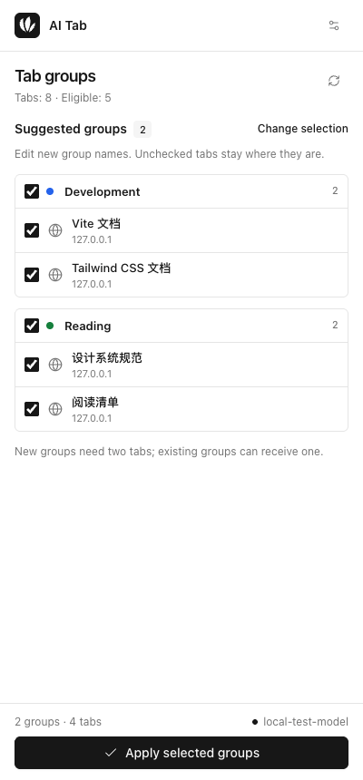

<p align="center">
  
</p>

<h1 align="center">AI Tab</h1>

<p align="center">Organize Chrome tabs with your own AI service.</p>

<p align="center">
  <strong>English</strong> · <a href="README.zh-CN.md">简体中文</a>
</p>

Select your tabs, review the suggestions, and apply them to Chrome's native tab groups. AI Tab works with OpenAI-compatible services, including gateways and local models.

<p align="center">
  <picture>
    <source media="(prefers-color-scheme: dark)" srcset="docs/images/preview-en-dark.png" />
    
  </picture>
</p>

## Features

- **Bring your own model.** Configure the API URL, key, model, and grouping preferences.
- **Review before applying.** Edit new group names, exclude individual tabs, or skip entire suggestions.
- **Reuse existing groups.** Add related tabs to matching groups while keeping their names and colors. A single tab can join an existing group.
- **Undo the last change.** Restore previous group membership, including after closing and reopening the side panel.
- **Find the tabs you need.** Search titles, sites, and group names. Select both grouped and ungrouped tabs for another pass.
- **Choose your language.** English and Simplified Chinese, with automatic light and dark appearance.

## Getting started

Requires **Chrome 140+**, **Node.js 24** (recommended), and the pnpm version specified in [`package.json`](package.json).

Clone or download this repository, then run:

```sh
pnpm install --frozen-lockfile
pnpm build
```

1. Open `chrome://extensions` and turn on **Developer mode**.
2. Click **Load unpacked** and select the generated `dist` folder.
3. Click the **AI Tab** toolbar icon to open the side panel.
4. Open **AI settings**, enter your service details, and click **Save and test**. Allow access to your API host when Chrome asks.
5. Select tabs, click **Suggest groups**, review the result, and click **Apply selected groups**.

To update a local installation, rebuild and reload the extension at `chrome://extensions`, then reopen the panel.

## Configuration

Use a service that supports the **OpenAI-compatible Chat Completions API**. Enter its base URL or full `/chat/completions` endpoint, a model available on that service, and an API key if required.

| Service                                                       | Example base URL                   |
| ------------------------------------------------------------- | ---------------------------------- |
| Hosted API or gateway                                         | `https://your-provider.example/v1` |
| [Ollama](https://docs.ollama.com/api/openai-compatibility)    | `http://localhost:11434/v1`        |
| [LM Studio](https://lmstudio.ai/docs/developer/openai-compat) | `http://localhost:1234/v1`         |

For local models, start the server and make the model available before testing the connection. Leave the key empty when authentication is not required. Remote services must use HTTPS; HTTP is allowed for `localhost`, `127.0.0.1`, and `[::1]`.

**Grouping preferences** let you describe the categories you want. For example:

> Keep GitHub repositories and their documentation together. Group the remaining tabs by topic. Use short group names.

The panel follows your browser language by default. Change **Settings → Language** to choose English or Simplified Chinese; suggested new group names follow that choice.

<details>
<summary>API compatibility and usage</summary>

Requests use `POST /chat/completions` with `model`, `messages`, and `stream: false`. JSON mode and tool calling are not required. Services that only expose the Responses API or Anthropic's native Messages API need a compatible gateway.

**Save and test** sends a short model request. Suggestions run only when requested, can be cancelled, and time out after 60 seconds. Your provider's usage charges apply.

</details>

## Grouping and undo

AI Tab works on selected tabs in the current window. It prefers adding tabs to a matching existing group; the preview labels these suggestions **Add to existing**. New groups need at least two tabs. Existing groups can receive one.

Pinned, loading, split-view, private, and non-HTTP/HTTPS tabs are excluded. Unselected tabs and tabs omitted from the suggestions stay where they are.

**Undo last grouping** restores the previous group membership for the latest operation. Undoing a merge moves back only the tabs added by that operation. Recovery is kept for the current browser session, survives reopening the panel, and does not restore tab order or overwrite later manual group edits. See [data and permissions](docs/privacy.md) for details.

## Privacy

Requests go directly to the AI service you configure. Your API key, if provided, is sent to that service for authentication. AI Tab has no application server, analytics, or telemetry.

- **Sent to your service:** selected tab IDs, titles, hostnames, and current group IDs; existing group IDs and names in the current window; your model choice and grouping preferences.
- **Not included:** page content, full tab URLs, cookies, browsing history, or unselected tab titles.
- **Stored in your browser:** service settings and language preference in local extension storage; original tab URLs and group metadata in session storage for undo. Neither uses Chrome Sync.

Tab titles, group names, and preferences can contain private information. Your chosen service handles this data under its own policy. Read the [data and permissions guide](docs/privacy.md) for the full request, storage, and permission details.

## Development

Built with **TypeScript**, **Vite**, **Tailwind CSS v4**, native **Web Components**, and **Lucide**. Formatting and linting use **Oxfmt**, **Oxlint**, and `@amamo/oxlint-config`.

```sh
pnpm dev              # Watch and rebuild the extension
pnpm format           # Format code and documentation
pnpm check            # Check formatting, lint, unit tests, types, and build

pnpm exec playwright install chromium
pnpm test:e2e         # Test the built extension in Chromium
```

Load `dist` in Chrome for development and reload the extension after changes. `pnpm preview` serves an installation page; extension features need Chrome's extension APIs.

Browser tests use an isolated profile and a local mock AI service, so no API key is needed. The [CI workflow](.github/workflows/ci.yml) runs the checks and uploads the built extension as `ai-tab-extension`.

## Contributing

Issues and pull requests are welcome. For bug reports, include your Chrome version, steps to reproduce, and expected behavior. Remove API keys and private tab information from examples and screenshots.

Keep changes focused, update both README languages when behavior changes, and run `pnpm check`. Run `pnpm test:e2e` for changes to the panel or browser integration.
