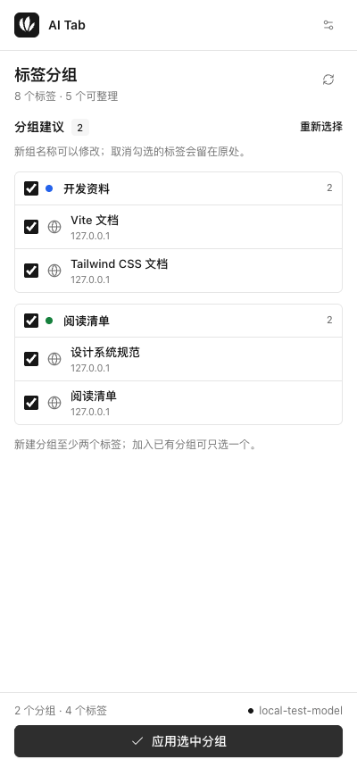

<p align="center">
  
</p>

<h1 align="center">AI Tab</h1>

<p align="center">使用你自己的 AI 服务，整理 Chrome 标签和书签。</p>

<p align="center">
  <a href="README.md">English</a> · <strong>简体中文</strong>
</p>

选择标签、预览建议，再应用到 Chrome 原生标签组。AI Tab 支持 OpenAI 兼容服务，可连接云端 API、网关或本地模型。

<p align="center">
  <picture>
    <source media="(prefers-color-scheme: dark)" srcset="docs/images/preview-dark.png" />
    
  </picture>
</p>

## 功能

- **自选服务和模型**：配置 API 地址、Key、模型名称和分组偏好。
- **确认后再整理**：修改新组名称，取消单个标签或整条分组建议。
- **复用已有分组**：将相关标签加入主题相符的分组，保留原名称和颜色；一个标签也可以加入已有组。
- **撤销上次操作**：恢复之前的分组归属，关闭并重开侧边栏后仍可撤销。
- **查找和重新整理**：按标题、网站或组名搜索，已分组和未分组的标签都可以选择。
- **中英文界面**：支持简体中文、英文，以及自动切换的浅色和深色外观。
- **整理书签**：选择文件夹、预览分类建议，再将选中书签移入已有或新建子文件夹；书签整理可独立撤销。

## 开始使用

需要 **Chrome 140+**、**Node.js 24**（推荐），以及 [`package.json`](package.json) 中指定的 pnpm 版本。

克隆或下载本仓库，在项目目录中运行：

```sh
pnpm install --frozen-lockfile
pnpm build
```

1. 打开 `chrome://extensions`，启用「开发者模式」。
2. 点击「加载已解压的扩展程序」，选择生成的 `dist` 文件夹。
3. 点击工具栏中的 **AI Tab** 图标，打开侧边栏。
4. 打开「AI 服务设置」，填写服务信息并点击「保存并测试」；Chrome 提示时，允许访问所填的 API 站点。
5. 选择标签，点击「生成分组建议」，确认后点击「应用选中分组」。

更新本地安装时，重新构建，在 `chrome://extensions` 中重新加载扩展，再打开侧边栏。

## 配置

使用支持 **OpenAI 兼容 Chat Completions API** 的服务。填写 Base URL 或完整的 `/chat/completions` 地址、该服务提供的模型名称，以及服务要求的 API Key。

| 服务                                                          | Base URL 示例                      |
| ------------------------------------------------------------- | ---------------------------------- |
| 云端 API 或网关                                               | `https://your-provider.example/v1` |
| [Ollama](https://docs.ollama.com/api/openai-compatibility)    | `http://localhost:11434/v1`        |
| [LM Studio](https://lmstudio.ai/docs/developer/openai-compat) | `http://localhost:1234/v1`         |

使用本地模型时，先启动服务并准备好模型，再测试连接。不需要身份验证的服务可将 Key 留空。远程服务必须使用 HTTPS；`localhost`、`127.0.0.1` 和 `[::1]` 允许使用 HTTP。

在「**分组偏好**」中描述你希望采用的分类方式，例如：

> 将 GitHub 仓库与对应文档放在一起，其余标签按主题分类，组名尽量简短。

界面默认跟随浏览器语言，也可在「设置 → 界面语言」中选择简体中文或英文。新生成的组名会使用所选语言。

<details>
<summary>接口兼容性与用量</summary>

请求使用 `POST /chat/completions`，包含 `model`、`messages` 和 `stream: false`，不要求服务支持 JSON 模式或工具调用。仅提供 Responses API 或 Anthropic 原生 Messages API 的服务，需要通过兼容网关接入。

「保存并测试」会发送一次简短的模型请求。分组建议只在主动点击时生成，请求可以取消，超时时间为 60 秒。用量按所选服务商的规则计费。

</details>

## 分组与撤销

AI Tab 只整理当前窗口中选中的标签，优先加入主题相符的已有分组，并在预览中标注「**加入已有**」。新建分组至少需要两个标签，加入已有分组只需一个。

固定标签、加载中的页面、分屏标签、隐身标签，以及非 HTTP/HTTPS 页面会被跳过。未选中或未被建议调整的标签保持原状。

「**撤销上次分组**」恢复最近一次操作前的分组归属。撤销合并时，只移回本次加入的标签。撤销记录保留在当前浏览器会话中，重开侧边栏后仍可使用；它不恢复标签顺序，也不覆盖之后的手动分组修改。详情见[数据与权限](docs/privacy.md)。

## 书签整理

切换到侧边栏的「**书签**」，首次点击「**允许访问书签**」。选择文件夹和书签，点击「**生成分类建议**」，预览后可修改新文件夹名称、取消单个书签或整条建议，再点击「**应用选中分类**」。书签与标签共用 AI 服务设置和分组偏好。

每次只整理所选文件夹中的直属 HTTP/HTTPS 书签，保留已有子文件夹内容，跳过受管理的书签，不改写标题或网址。优先使用匹配的已有子文件夹，已有文件夹可接收一个书签，新文件夹至少需要两个。每次最多选择 200 个，初始选中前 200 个；较大的文件夹可分多次整理。

「**撤销上次书签整理**」尽可能恢复原文件夹和排列位置，同一次浏览器会话中重开面板后仍可使用。后来被移动或修改的项目会跳过；仅删除本次创建且仍为空、未被修改的文件夹。所有窗口共用最近一次书签撤销记录，与标签分组的撤销记录独立。若启用了 Chrome 书签同步，原生书签的变更可能同步到其他设备。

## 隐私

请求直接发往你配置的 AI 服务；如果填写了 API Key，也会发送给该服务用于身份验证。AI Tab 没有应用服务器、统计代码或遥测。

- **发送给服务**：选中标签的 ID、标题、域名和当前分组 ID，当前窗口已有分组的 ID 和名称，以及模型选择和分组偏好。
- **书签分类请求**：选中书签的 ID、标题和域名，以及可写子文件夹的 ID 和名称；不包含完整网址或其他书签的标题。
- **不包含**：网页正文、标签的完整 URL、Cookie、浏览历史，以及未选中标签的标题。
- **保存在浏览器**：服务配置和语言偏好存入扩展本地存储；原始标签或书签 URL、分组或文件夹信息及书签位置存入会话存储，用于撤销。扩展存储不使用 Chrome Sync。

标签标题、分组名称和偏好可能包含私人信息，所选服务按其自身政策处理这些数据。完整的请求内容、存储方式和权限用途见[数据与权限](docs/privacy.md)。

## 开发

使用 **TypeScript**、**Vite**、**Tailwind CSS v4**、原生 **Web Components** 和 **Lucide**。格式化与代码检查使用 **Oxfmt**、**Oxlint** 和 `@amamo/oxlint-config`。

```sh
pnpm dev              # 监听修改并重新构建扩展
pnpm format           # 格式化代码与文档
pnpm check            # 格式检查、Lint、单元测试、类型检查和构建

pnpm exec playwright install chromium
pnpm test:e2e         # 在 Chromium 中测试构建后的扩展
```

开发时在 Chrome 中加载 `dist`，修改后重新加载扩展。`pnpm preview` 提供安装提示页；扩展功能需要 Chrome 扩展 API。

浏览器测试使用独立配置和本地模拟 AI 服务，无需 API Key。[CI 工作流](.github/workflows/ci.yml) 运行检查，并将构建产物上传为 `ai-tab-extension`。

## 参与贡献

欢迎提交 Issue 和 Pull Request。报告问题时，请附上 Chrome 版本、复现步骤和预期行为，并移除示例及截图中的 API Key 和私人标签信息。

每次修改尽量围绕一个问题；涉及已记录的功能变化时，同步更新中英文 README，并运行 `pnpm check`。修改侧边栏或浏览器集成时，运行 `pnpm test:e2e`。
